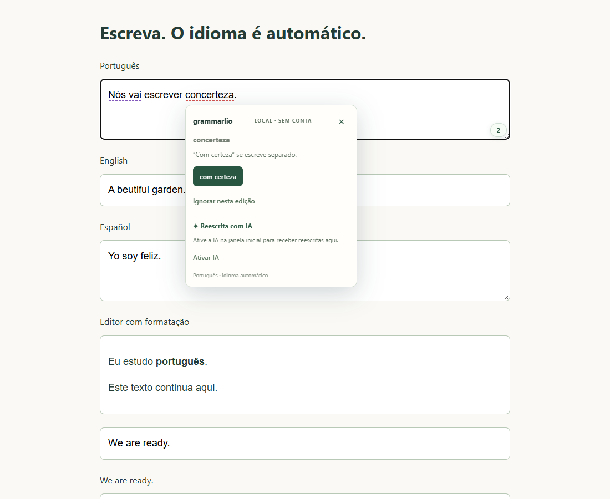

# Grammarlio ✦

**Assistente de escrita gratuito e open source para Chrome e Edge. Português, inglês e espanhol com idioma automático. Sem conta ou assinatura. Texto processado no navegador.**

[English guide](docs/README.en.md) · [Privacidade](PRIVACY.md) · [Contribuir](CONTRIBUTING.md)

## Versão 0.4.1 — escreva direto no site

- Instale e escreva normalmente. Após uma pausa, erros reconhecidos recebem sublinhados. **Passe o mouse sobre a palavra** para ver sugestões e aplicar uma correção ali mesmo.
- A reescrita com IA aparece nesse cartão. Não precisa importar texto, abrir painel ou escolher idioma. Alternativas de estilo também podem aparecer em frases sem erro de dicionário.
- Na primeira instalação, uma janela pergunta **“Ativar a reescrita com IA?”**. **Sim** baixa e prepara o modelo com progresso visível. **Agora não** mantém as correções básicas funcionando, sem baixar o modelo. A ativação continua acessível pelo ícone e pelos cartões.
- O popup oferece **um botão de ligar/desligar**, estado da IA e acesso à ativação quando necessário. Não há painel de edição ou configurações de idioma.
- O idioma é identificado pelo texto, por frase, inclusive em campos que misturam os três idiomas. A língua do site apenas desempata. Frases curtas, nomes e palavras compartilhadas podem ser ambíguos.
- Aceite, ignore ou adicione uma palavra ao dicionário pessoal local. Nenhuma sugestão altera seu texto antes de você aceitar.



**Experimental:** ainda não oferece a cobertura ou qualidade do Grammarly. As regras são iniciais e a IA pode mudar o sentido ou errar. Confira fatos, nomes e números antes de aceitar.

## Correções de compatibilidade na 0.4.1

`knowldge → knowledge` é verificado em editores ricos, frames `about:blank`/`srcdoc`, documentos editáveis (`designMode`), campos que se tornam editáveis depois do foco, Shadow DOM aberto e diálogos modais nativos. A extensão também se recupera quando o editor recria o documento do frame. Passar o mouse abre o cartão; aceitar preserva o restante do texto e a formatação.

Esses testes usam exemplos locais desses tipos de editor. **O editor da conta do usuário no Pipedrive ainda não foi inspecionado diretamente**, portanto não é uma garantia de compatibilidade com essa conta ou todas as versões do produto. Veja [evidências de compatibilidade](docs/COMPATIBILITY.md).

## Instalar

1. Baixe `grammarlio-0.4.1.zip` em [Releases](https://github.com/blajeen/Grammarlio/releases) e extraia para uma pasta permanente.
2. Abra `chrome://extensions` no Chrome ou `edge://extensions` no Edge.
3. Ative **Modo do desenvolvedor**, clique em **Carregar sem compactação** e selecione a pasta com `manifest.json`.
4. A janela de ativação abre automaticamente. Escolha **Sim, ativar IA** ou **Agora não**. As correções básicas já estão ligadas.
5. Escreva em um campo de um site e passe o mouse sobre os sublinhados. Fixar o ícone é opcional; ele abre o controle de ligar/desligar.

Ainda não publicada nas lojas. A instalação manual não exige conta no Grammarlio ou no GitHub. Para atualizar, substitua os arquivos, recarregue a extensão, aceite novas permissões se solicitado e recarregue as abas dos sites. Na primeira instalação também tentamos ativar abas HTTP/HTTPS já abertas.

## Dicionários, IA e custo

As bases abertas completas `.aff` e `.dic` são incluídas no pacote e funcionam sem internet:

| Idioma | Base | Entradas-base |
| --- | --- | ---: |
| Português brasileiro | VERO / LibreOffice | 312.368 |
| Inglês americano | SCOWL + ESDB ampliado (união das bases) | 80.701 |
| Espanhol es-ES | LibreOffice, Santiago Bosio e colaboradores | 57.344 |

A ampliação inglesa inclui os arquivos oficiais ESDB/SCOWL en_US-large 2026.02.25 (76.958 entradas), preservando a base anterior e priorizando suas sugestões comuns. A união contém 80.701 grafias-base distintas. O build verifica os hashes e inclui as licenças. Bases maiores aceitam também palavras raras que podem parecer erros de outras palavras; não existe vocabulário universal ou detecção perfeita. Português e espanhol continuam com seus arquivos completos.

Hunspell aplica também as flexões dos arquivos de afixos. “Completo” significa os arquivos integrais dessas bases, não toda palavra existente, definições ou cobertura universal de termos técnicos. Gramática vem de regras originais; reescrita vem do **Qwen3-1.7B q4f32_1 via WebLLM**. Não usamos bases do Grammarly nem consultamos a internet para revisar frases.

**Sem custo por texto, mensalidade ou plano pago.** A execução usa o computador do usuário: internet no download inicial, disco, memória e energia. Manutenção e eventual publicação nas lojas podem ter custos para o mantenedor.

Para a IA:

- Download inicial da ordem de **1 GB**, após aceitar a ativação. Dados vêm do Hugging Face e sua infraestrutura; textos não acompanham essas requisições.
- Navegador recente com **WebGPU**, aceleração gráfica e GPU/driver compatíveis. Reserve aproximadamente **3 GB de memória gráfica**; o catálogo estima 2,6 GB, com memória adicional do sistema.
- Após o download completo, o modelo fica no cache e carrega automaticamente nos próximos usos. Recarga offline foi testada, mas depende de o navegador conservar os arquivos. O consentimento permite baixar novamente arquivos ausentes após perda do cache.
- Desligar suspende a revisão e libera a IA da memória, preservando cache e consentimento. Ligar retoma o carregamento automático no próximo uso.
- Sem GPU compatível, correções básicas continuam disponíveis. Falhas de download/GPU aparecem na ativação e no cartão, com acesso para tentar novamente.

Não existe servidor de inferência. Conhecimento linguístico vem dos pesos previamente treinados; textos do usuário não treinam o modelo.

## Compatibilidade e limites

Funciona em `textarea`, inputs de texto/busca e `contenteditable` compatíveis, incluindo frames HTTP/HTTPS e frames internos com origem HTTP/HTTPS herdada. Apenas o campo em foco de uma página visível é revisado. O overlay não insere marcações no conteúdo. Ao aceitar, usa edição nativa e confere novamente o texto para evitar sobrescrever alterações recentes.

Senhas, tipos sensíveis, códigos identificados, readonly/disabled e campos opt-out são excluídos. Sites podem excluir um campo com `data-grammarlio="off"` ou `data-gramm="false"` no campo/ancestral. A identificação depende da marcação do site.

Limites técnicos: **12.000 caracteres por campo**, até **80 achados**, frase/seleção de até **3.000 caracteres** por reescrita e até **600 caracteres de contexto vizinho do mesmo campo**. Nada é cortado silenciosamente. Uma geração por vez; cache temporário de até oito sugestões no campo. Não são limites de plano pago.

Sem integração garantida com Google Docs/canvas, editores de estrutura própria, Shadow DOM fechado, transformações CSS complexas ou diálogos nativos sobre o overlay. Páginas internas do navegador e lojas bloqueiam a extensão. **Ctrl+Alt+G** abre sugestões; **Esc** fecha. A interface atual está em português.

## Privacidade e permissões

Sem telemetria, anúncios, histórico de textos ou sincronização de conta. Ativação global, consentimento da IA e palavras pessoais são salvos localmente; pesos ficam no cache. Texto, contexto e respostas ficam na memória local durante o uso. O site original continua sujeito à própria política. Veja [PRIVACY.md](PRIVACY.md).

| Acesso | Finalidade |
| --- | --- |
| `scripting` e sites HTTP/HTTPS | Ativar revisão nos campos, inclusive abas já abertas na instalação |
| `storage` | Guardar ativação, consentimento e palavras pessoais no dispositivo |
| `offscreen` | Compartilhar workers de dicionários e IA sem abrir painel |

JavaScript e WASM executáveis ficam no pacote. Downloads posteriores contêm dados do modelo, sem código remoto.

## Compilar e testar

Requer Node.js 22+ e npm:

```sh
git clone https://github.com/blajeen/Grammarlio.git
cd Grammarlio
npm ci
npm run check
npx playwright install chromium
npm run test:browser
npm run test:inline
npm run test:editors
```

Carregue `dist` sem compactação. O build verifica o SHA-256 do runtime fixado em `model-lock.json`. Dependências têm versões e integridade fixadas em `package-lock.json`.

Teste opcional com IA real, GPU e download grande, em perfil isolado:

```sh
node scripts/hover-ai-test.mjs --browser=msedge --profile=artifacts/edge-ai
node scripts/hover-ai-test.mjs --browser=chromium --profile=artifacts/chromium-ai
```

Veja [resultados e limitações](docs/VALIDATION.md), [testes](docs/TESTING.md) e [arquitetura](docs/INLINE.md). Os testes usam textos sintéticos e nunca a sessão pessoal do navegador.

## Licença e créditos

Código: [MIT](LICENSE). Dicionários, modelo e bibliotecas mantêm suas licenças em [THIRD_PARTY_NOTICES.md](THIRD_PARTY_NOTICES.md). Ícone original criado com **ImageGen**, com [arquivo e prompt documentados](docs/ICON.md). Não afiliado ao Grammarly, Google ou Microsoft.
